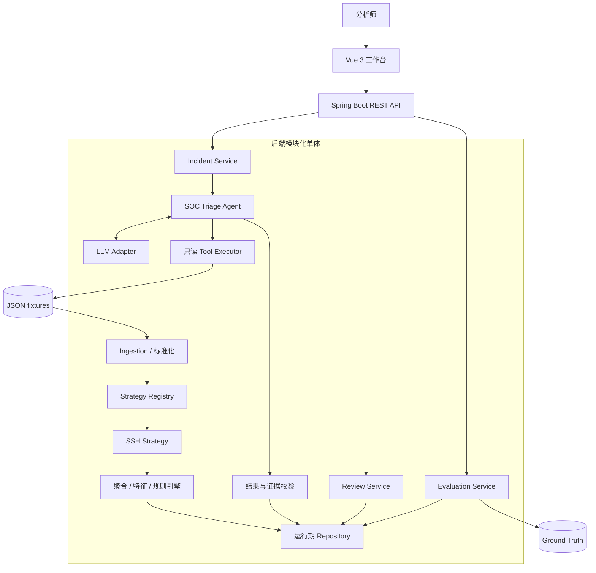

# ARCHITECTURE.md — SecOps Copilot

> **架构版本：** V1.3  
> **对应需求：** `PRD.md` V1.3  
> **领域字段：** `DATABASE.md` V1.3  
> **接口契约：** `API.md` V1.3  
> **部署形态：** 本地前后端分离单体应用

## 1. 架构目标与决策

本架构服务于复试 Demo，优先保证核心流程可运行、可解释、可追溯，不建设完整生产级 SOC。

### 1.1 核心技术栈

| 层次 | 技术 | 职责 |
|---|---|---|
| 前端 | Vue 3、TypeScript、Vite | 工作台与交互 |
| UI/图表 | Element Plus、ECharts | 告警、事件和评估展示 |
| 后端 | Java 17、Spring Boot | REST API 与业务编排 |
| AI 集成 | Spring AI Alibaba | 模型与 Function Calling 适配 |
| 模型 | DashScope / 支持工具调用的通义千问模型 | 辅助研判 |
| 初始数据 | JSON fixtures | 告警、资产、历史登录、运维记录、Ground Truth |
| 运行期数据 | In-Memory Repository | Incident、AI 结果、工具轨迹、审核记录 |

具体依赖版本以项目实际选择为准，固定在 Maven 和前端 lockfile 中。Spring AI Alibaba SDK 类型集中在适配层，不散落到业务代码。

### 1.2 关键架构决策

1. 前后端分离的模块化单体，不拆微服务。
2. 统一 `Alert` 模型，类型专属字段放入 `attributes`。
3. 通过 `alertType` 路由到类型化策略，本期只注册 SSH 策略。
4. 聚合、特征和规则评分由 Java 完成；LLM 负责语义研判和按需取证。
5. 单个 SOC Triage Agent + 有界 ReAct + 只读工具，不使用 Multi-Agent。
6. JSON 只读 fixtures + 内存 Repository，不引入 MySQL、Redis、MQ 或向量数据库。
7. Ground Truth 与 Agent、Tool 模块隔离。
8. AI 输出必须经过结构和证据引用校验；最终业务结论由人工审核。

## 2. 逻辑架构与模块职责



| 模块 | 职责 | 不负责 |
|---|---|---|
| `ingestion` | 加载、解析、校验和标准化告警 | 攻击研判 |
| `strategy` | 策略注册、按 `alertType` 路由、构建类型化上下文 | 直接调用 LLM |
| `engine` | 告警聚合、特征提取、规则评分 | 自然语言研判 |
| `agent` | Agent 有界执行循环、上下文编排 | 读取 Ground Truth、修改审核状态 |
| `tools` | 白名单只读工具、参数校验、执行轨迹 | 任意文件/SQL/Shell/URL 访问 |
| `ai` | LLM 适配、Prompt、结构化输出解析 | 领域业务状态更新 |
| `service` | 业务用例编排、状态变更 | Controller 层职责 |
| `repository` | 数据访问和内存实现 | 聚合、评分、Agent 编排 |
| `evaluation` | 读取评估数据并计算指标 | 将标签提供给 Agent |
| `controller` | HTTP 参数校验、调用 Service、返回 DTO | 业务规则实现 |

## 3. 核心处理流程

### 3.1 启动与告警接入

1. 应用启动时从 `resources/mock/` 加载 JSON fixtures。
2. 将告警映射为统一 `Alert`，校验必填字段、枚举、时间和唯一 ID。
3. 保留原始 `rawLog` 与类型化 `attributes`；原始日志作为不可信文本。
4. 通过 `AlertStrategyRegistry` 判断策略支持状态。
5. 未注册策略的告警保留在原始告警列表，不创建可研判 Incident。
6. 对 `SSH_BRUTE_FORCE` 调用 SSH 策略，生成 Incident、特征和规则评分。

`alertType` 在本期模拟数据中由数据源提供，不宣称具备 AI 告警类型识别能力。

### 3.2 策略接口

```java
public interface AlertAnalysisStrategy {
    String getAlertType();
    List<Incident> aggregate(List<Alert> alerts);
    SecurityFeatures extractFeatures(Incident incident, List<Alert> alerts);
    RiskAssessment assessRisk(SecurityFeatures features);
    AIAnalysisContext buildContext(Incident incident, List<Alert> alerts);
    String getPromptTemplate();
}
```

本期注册：

```text
SSH_BRUTE_FORCE -> SshBruteForceStrategy
```

其他类型不注册策略。新增类型时再实现其聚合、特征、评分、Prompt 和评估用例。

### 3.3 SSH 告警聚合

聚合键：

```text
alertType + sourceIp + targetAsset + attributes.protocol
```

算法：

1. 过滤 `SSH_BRUTE_FORCE`，按聚合键分组。
2. 若 `sourceIp`、`targetAsset` 或 `protocol` 缺失，该告警单独形成事件，不与其他缺失值告警合并。
3. 组内按 `timestamp` 升序排序。
4. 以当前事件第一条告警时间为窗口起点。
5. `timestamp - windowStart <= 5 分钟` 时加入当前事件；超过 5 分钟则创建新事件。
6. 保证一个 Alert 最多关联一个 Incident，`alertCount == alertIds.size()`。

`scenarioId` 不得进入聚合键。评估场景与事件的一对一关系由模拟数据生成规则保证，具体约束见 `DATABASE.md`。

### 3.4 特征提取与规则评分

特征由 Java 根据关联告警和 `assets.json` 计算。缺失数据显式标记为 `null` 或 `UNKNOWN`，不使用猜测值。

风险规则、分值和等级映射以 `PRD.md` 为业务定义、`DATABASE.md` 为字段定义。每个命中规则保存 `ruleCode`、描述、分值和 `supportingFacts`。规则分数不等同于攻击概率。

## 4. SOC Triage Agent

### 4.1 职责边界

Agent 接收策略构建的 `AIAnalysisContext`，基于已有事实决定是否需要查询额外信息，通过 Function Calling 请求工具，整合工具结果并生成结构化研判。

Agent 不负责：

- 解析全部原始日志或重新计算确定性特征。
- 修改规则风险分数。
- 访问 Ground Truth。
- 修改最终人工审核状态。
- 执行封禁、隔离或其他安全处置。

### 4.2 上下文构建

上下文至少包括：事件编号、告警类型、来源 IP、目标资产、时间范围、关联告警数量、SSH 特征、规则评分及命中原因、少量代表性日志和有效 Alert ID。

- 只传递当前事件所需数据，限制日志数量和长度。
- 不传递 `scenarioId`、`expectedLabel`、`expectedToolPlan` 或 Ground Truth notes。
- 原始日志和工具返回文本作为不可信数据，不允许其中的指令覆盖系统 Prompt。

### 4.3 工具注册与权限

本期工具白名单与优先级：

- **P0：** `query_login_history`，查询当前来源 IP 在目标资产上的历史登录行为，必须完成真实调用。
- **P1：** `query_authorized_operations`，查询目标资产在事件附近是否存在授权运维记录；核心闭环完成后再实现。

工具只读取 `login-history.json` 和 `authorized-operations.json`。工具参数、返回结构及校验规则以 `API.md` 第 14 节为准。

后端必须将工具调用绑定到当前 Incident：

- `sourceIp`、`targetAsset` 必须与当前事件一致。
- 历史登录查询的结束时间由后端锚定为 `incident.firstSeen`，查询区间为 `[firstSeen - lookbackHours, firstSeen)`，不使用工具执行时的当前时间。
- 授权运维查询的资产必须与当前事件一致；查询时间必须位于事件时间附近的允许范围内，且跨度不超过 30 分钟。
- 模型不能指定任意 Java 方法、文件路径、URL、SQL 或 Shell。

### 4.4 有界 ReAct 执行

```text
Incident Context
      |
      v
LLM + Tool Definitions
      |
      +---- Final JSON --------------------+
      |                                    |
      +---- Tool Call                      |
              |                            |
        后端白名单与参数校验                 |
              |                            |
          执行只读工具                       |
              |                            |
        记录 ToolCallTrace                  |
              |                            |
        Tool Result 回填 LLM                |
              |                            |
          下一轮模型调用 -------------------+
                                           |
                                  结构化解析与证据校验
                                           |
                                      保存 AIAnalysis
```

执行上限：

- 最多 2 轮工具调用循环。
- 单次研判最多 4 次工具调用。
- 单工具超时建议 3 秒；Agent 总耗时上限 45 秒（实测平台响应抖动，30 秒下集成测试偶发超时）。
- 达到上限后停止工具调用，基于已有证据输出或失败，不继续循环。
- 不需要工具时允许直接输出最终结果。

异常策略：

| 情况 | 处理 |
|---|---|
| 单个工具失败/超时/拒绝 | 记录失败轨迹，将结构化错误反馈给模型；模型仍可基于现有证据完成研判 |
| Function Calling 不可用，但普通结构化生成可用 | 可执行无工具降级研判，`executionMode=NO_TOOL_FALLBACK`，在不确定性中说明未查询工具 |
| 模型服务不可用或总调用失败 | `analysisStatus=FAILED`，事件进入 `ANALYSIS_FAILED`，保留规则结果 |
| 最终 JSON 无法解析或必填字段非法 | 研判失败，不保存为成功结果 |

### 4.5 结果校验

后端校验 JSON 结构、必填字段、枚举、字符串和数组长度、当前 Incident 关联关系，以及证据 ID。

证据约束：

- `sourceType=ALERT`：`alertIds` 必须非空且全部属于当前 Incident；`toolCallIds` 为空。
- `sourceType=TOOL`：`toolCallIds` 必须非空且全部属于本次研判中成功执行的工具调用；`alertIds` 为空。
- 引用不合法的证据项不得作为有效证据展示。若报告结构有效但部分证据项被剔除，标记 `PARTIALLY_VALID`；全部有效时为 `VALID`。
- 必填结构或核心字段不合法时，整次输出判定失败，`validationStatus=INVALID`。
- 引用存在只代表可追溯，不代表语义解释必然正确；语义支持率需人工抽样。

不展示模型隐藏思维链，只展示 `reasoningSummary`、证据和真实工具动作。

## 5. 事件状态与并发控制

`Incident.status` 和 `Incident.analysisStatus` 分开维护：前者是业务流程状态，后者是最近一次 AI 研判执行状态。状态枚举及允许审核的状态以 `DATABASE.md` 为准。

- 仅允许从 `PENDING_ANALYSIS`、`ANALYSIS_FAILED`、`INVESTIGATING` 触发研判；`ANALYZING` 返回并发冲突，`PENDING_REVIEW` 本期不重复研判。
- 开始研判前通过 Service 原子检查并将状态更新为 `ANALYZING/RUNNING`，阻止同一事件并发研判。
- 成功后更新为 `PENDING_REVIEW/SUCCEEDED`。
- 失败后更新为 `ANALYSIS_FAILED/FAILED`。
- 审核状态更新与追加 `ReviewRecord` 必须在同一 Service 操作中完成。
- 审核仅允许从 `PENDING_ANALYSIS`、`PENDING_REVIEW`、`ANALYSIS_FAILED`、`INVESTIGATING` 提交。
- 已处于 `CONFIRMED_THREAT` 或 `FALSE_POSITIVE` 的事件不允许重复审核或重新研判。

## 6. 存储与评估

### 6.1 存储

只读 JSON fixtures：

```text
backend/src/main/resources/mock/
  alerts.json
  assets.json
  login-history.json
  authorized-operations.json
  ground-truth.json
```

运行期内存 Repository 保存标准化告警、Incident、AIAnalysis、ToolCallTrace、ReviewRecord 和评估结果。应用重启后运行期状态可重置，README 必须说明。

### 6.2 Ground Truth 隔离

只有 `EvaluationService` 可以依赖 `EvaluationRepository`。Agent、Prompt Builder、Tool Registry 和 Tool 实现不得注入或读取 Ground Truth。评估只读取实际运行产物与独立标签进行比较，不触发模型调用。

评估口径和样本纳入条件以 `PRD.md` 为准。

## 7. API 与前端

公共 HTTP 接口、字段、错误码和内部工具契约全部以 `API.md` 为准。前端只调用公共 API，不直接调用 DashScope 或内部工具。

前端页面：

- Dashboard：告警分类、类型分布和事件统计。
- Alerts & Incidents：原始告警与聚合事件。
- Reviews：人工审核与审核记录。
- Evaluation：基于真实数据的评估结果。

未支持策略的告警不显示研判按钮；研判期间禁用重复提交；模型不可用时仍可查看基础告警和规则结果。

## 8. 建议目录结构

```text
secops-copilot/
├── frontend/src/{app,layouts,views,components,api,types,styles}/
├── backend/src/main/java/com/secops/
│   ├── controller/ service/ ingestion/ strategy/ engine/
│   ├── agent/ tools/ ai/ model/ repository/ evaluation/ config/ common/
│   └── resources/{mock,prompts}/
├── docs/{PRD,ARCHITECTURE,DATABASE,API}.md
├── AGENTS.md
├── .env.example
└── README.md
```

按实际需要创建文件，不为目录完整而创建空类。

## 9. 测试要求

至少覆盖：

- JSON 加载、字段校验、重复 Alert ID 和未支持策略。
- 聚合键、5 分钟边界、缺失关键字段和单条告警事件。
- 特征计算、规则区间互斥和分数上限。
- 工具参数与 Incident 绑定、时间范围、超时和失败轨迹。
- Agent 不调用工具、调用工具、达到上限、工具失败、模型失败和无工具降级。
- Alert ID / Tool Call ID 证据校验。
- 人工审核状态流转和并发重复请求。
- Ground Truth 不进入模型上下文；评估空样本和除零处理。

使用 Mock LLM/Tool 进行自动化测试；真实模型调用仅用于显式手动集成测试（`mvn -Dtest=DashScopeLiveIT test`），不进入默认 `mvn test`。

## 10. 配置与运行约束

模型密钥统一通过后端环境变量 `SECOPS_API_KEY` 读取（兼容别名 `SECOPS_COPILOT_API_KEY`，候选名由 `app.model.api-key-env` 配置），只由后端读取，不进入前端、Git 或日志。默认接入 OpenAI 兼容协议平台（硅基流动 / 轨迹流动，`https://api.siliconflow.cn/v1`），通过 `app.model.provider` 切换；DashScope 原生 SDK 适配路径保留但非默认。Agent 参数建议：

```yaml
app:
  agent:
    max-tool-rounds: 2
    max-tool-calls: 4
    tool-timeout-ms: 3000
    total-timeout-ms: 45000
```

具体模型配置键以项目使用的 Spring AI Alibaba 版本为准。不得编造 SDK 类、注解或配置项。运行期内存状态重启后重置；不得修改原始 JSON fixtures。

## 阶段三口径补充（2026-11-19，用户确认）

- 历史登录工具的 `knownSource` 在本 Demo 中表示查询窗口内至少有一次成功登录；与 `hasSuccessfulLogin` 同值，不代表生产系统的可信来源认证。
- 可执行工具仍受后端白名单限制。非法工具请求不执行，但允许其请求名称（最长128字符）出现在 `REJECTED` 轨迹，参数摘要为空；该轨迹不能作为成功证据。
- 阶段三先启用 `query_login_history`；P1 授权运维工具后续已按 API.md 14.2 实现。结构校验字符串上限2000字符，数组上限20项，最终输出上限50000字符；代表日志最多3条、每条500字符。

**文档结束**
