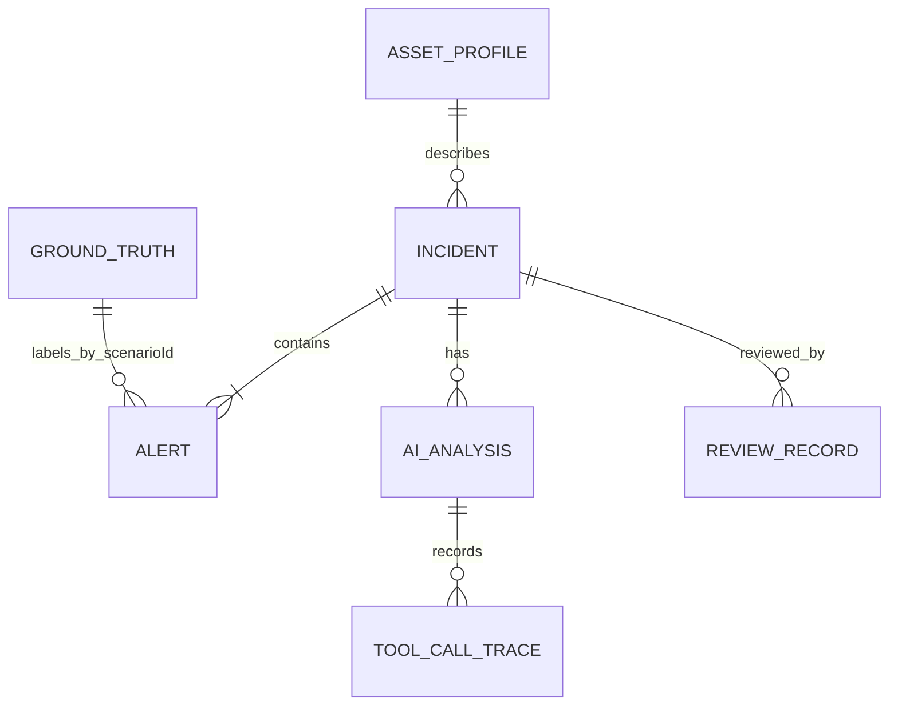

# DATABASE.md — SecOps Copilot

> **数据模型版本：** V1.3  
> **对应文档：** `PRD.md`、`ARCHITECTURE.md`、`API.md` V1.3  
> **本期存储：** JSON 初始数据 + In-Memory Repository  
> **说明：** 本文定义逻辑实体和运行期对象，不要求创建关系型数据库或 SQL DDL。

## 1. 存储策略

| 数据 | 存储 | 可修改 | 说明 |
|---|---|---|---|
| 原始告警 | `alerts.json` | 否 | 多类型模拟告警 |
| 资产信息 | `assets.json` | 否 | 资产重要性、公网暴露情况 |
| 历史登录 | `login-history.json` | 否 | Agent 只读查询数据 |
| 授权运维 | `authorized-operations.json` | 否 | Agent 只读查询数据 |
| Ground Truth | `ground-truth.json` | 否 | 仅评估模块可访问 |
| 标准化 Alert | 内存 Repository | 运行期只读 | 从 fixtures 加载并校验 |
| Incident | 内存 Repository | 是 | 聚合生成，状态随流程更新 |
| AIAnalysis / ToolCallTrace | 内存 Repository | 追加 | 每次研判单独留痕 |
| ReviewRecord | 内存 Repository | 追加 | 不覆盖历史审核 |
| EvaluationResult | 内存计算结果 | 可重算 | 不修改 Ground Truth |

运行期数据在应用重启后可以重置，README 必须说明。本期不引入 MySQL、Redis、消息队列或向量数据库。初始 JSON fixtures 不得被业务操作覆盖。

## 2. 通用字段约定

- 主键使用 String，如 `ALERT-0001`、`INC-20261118-001`、`ANL-<UUID短码>`。
- 时间使用 ISO 8601 且带时区；Java 内部统一使用 `Instant`。
- 枚举使用大写下划线。
- `attributes`、`features`、`riskAssessment` 等对象使用 JSON Object，不得把 JSON 再序列化成字符串。
- 风险分数和计数使用数值类型。
- `rawLog` 是不可信文本。
- `scenarioId` 只用于合成数据评估关联，不是生产告警的必需字段，也不得参与聚合或 Agent 决策；普通业务 API 不返回该字段。

## 3. 实体关系



本期内存模型中，`Alert.incidentId` 可不落在原始 JSON 中；通过 `Incident.alertIds` 维护关联。一个 Alert 最多属于一个 Incident。`GroundTruth` 通过 `scenarioId` 与关联 Alert 间接匹配，具体约束见第 7 节，不建立独立 Scenario 表。

## 4. 枚举

| 字段 | 允许值 |
|---|---|
| `alertType` | `SSH_BRUTE_FORCE`、`PORT_SCAN`、`SQL_INJECTION`、`MALWARE_ACTIVITY`、`UNKNOWN` |
| `category` | `AUTHENTICATION`、`NETWORK`、`WEB_ATTACK`、`HOST_SECURITY`、`DATA_SECURITY`、`UNKNOWN` |
| 原始告警 `severity` | `CRITICAL`、`HIGH`、`MEDIUM`、`LOW`、`INFO` |
| 规则/AI `riskLevel` | `CRITICAL`、`HIGH`、`MEDIUM`、`LOW` |
| AI `verdict` | `SUSPICIOUS`、`LIKELY_BENIGN`、`NEEDS_REVIEW` |
| Incident `status` | `PENDING_ANALYSIS`、`ANALYZING`、`PENDING_REVIEW`、`ANALYSIS_FAILED`、`CONFIRMED_THREAT`、`FALSE_POSITIVE`、`INVESTIGATING` |
| Incident `analysisStatus` | `NOT_STARTED`、`RUNNING`、`SUCCEEDED`、`FAILED` |
| AIAnalysis `analysisStatus` | `SUCCEEDED`、`FAILED` |
| `strategySupport` | `SUPPORTED`、`UNSUPPORTED`（由策略注册表计算，不写入 Alert fixtures） |
| Tool `executionStatus` | `SUCCESS`、`FAILED`、`TIMEOUT`、`REJECTED` |
| Evidence `sourceType` | `ALERT`、`TOOL` |
| Review `reviewResult` | `CONFIRMED_THREAT`、`FALSE_POSITIVE`、`INVESTIGATING` |
| Ground Truth `expectedLabel` | `ATTACK`、`BENIGN`、`UNCERTAIN` |
| AI `validationStatus` | `VALID`、`PARTIALLY_VALID`、`INVALID` |
| AI `executionMode` | `TOOL_ENABLED`、`NO_TOOL_FALLBACK` |

`Incident.status` 表示业务处理状态；`analysisStatus` 表示最近一次 AI 研判状态，不能混用。

## 5. 核心实体

### 5.1 Alert — 原始安全告警

| 字段 | 类型 | 必填 | 说明 |
|---|---|---:|---|
| `alertId` | String | 是 | 唯一告警 ID |
| `scenarioId` | String | 否 | 合成数据场景 ID，仅评估使用 |
| `alertType` | String | 是 | 具体告警类型 |
| `category` | String | 是 | 告警类别 |
| `timestamp` | DateTime | 是 | 发生时间 |
| `sourceIp` | String | 否 | 来源 IP |
| `targetIp` | String | 否 | 目标 IP |
| `targetAsset` | String | 否 | 目标资产名称 |
| `severity` | String | 是 | 原始告警等级 |
| `sourceSystem` | String | 否 | 来源系统，如 `SIMULATED_SIEM` |
| `attributes` | Object | 否 | 类型专属字段 |
| `rawLog` | String | 否 | 原始日志文本 |

SSH `attributes`：`protocol`、`username`、`action`。其中 `action` 为 `LOGIN_FAILED` 或 `LOGIN_SUCCESS`。

### 5.2 Incident — 聚合安全事件

| 字段 | 类型 | 必填 | 说明 |
|---|---|---:|---|
| `incidentId` | String | 是 | 事件唯一 ID |
| `alertType` | String | 是 | 事件类型；一个事件只能有一种类型 |
| `category` | String | 是 | 告警类别 |
| `sourceIp` | String/null | 否 | 来源 IP |
| `targetIp` | String/null | 否 | 目标 IP |
| `targetAsset` | String/null | 否 | 目标资产 |
| `firstSeen` | DateTime | 是 | 最早告警时间 |
| `lastSeen` | DateTime | 是 | 最晚告警时间 |
| `alertIds` | String[] | 是 | 关联 Alert ID |
| `alertCount` | Integer | 是 | 必须等于 `alertIds.length` |
| `features` | SecurityFeatures | 是 | 类型化特征 |
| `riskAssessment` | RiskAssessment | 是 | 规则风险评估 |
| `analysisStatus` | String | 是 | 最近一次 AI 研判状态 |
| `status` | String | 是 | 事件业务状态 |
| `createdAt` | DateTime | 是 | 创建时间 |
| `updatedAt` | DateTime | 是 | 更新时间 |

约束：`firstSeen <= lastSeen`；所有 `alertIds` 必须存在且类型一致；一个 Alert 最多关联一个 Incident；未注册策略的告警不创建 Incident。

### 5.3 SecurityFeatures — 安全特征

本期 SSH 策略至少包含：

| 字段 | 类型 | 说明 |
|---|---|---|
| `failedAttempts` | Integer | 登录失败次数 |
| `successfulAttempts` | Integer | 登录成功次数 |
| `distinctUserCount` | Integer | 不同用户名数量 |
| `windowSeconds` | Long | `lastSeen - firstSeen` 秒数 |
| `windowMinutes` | Number | 时间跨度分钟数 |
| `failureRate` | Number | 每分钟失败次数 |
| `successAfterFailure` | Boolean | 是否先失败后成功 |
| `publicExposure` | Boolean/null | 资产是否公网暴露；未知为 null |
| `assetCriticality` | String | `HIGH`、`MEDIUM`、`LOW`、`UNKNOWN` |

`failureRate = failedAttempts / max(windowSeconds / 60, 1 / 60)`。特征必须由后端计算或从明确数据源查询，不允许 LLM 自行计算。

### 5.4 RiskAssessment — 规则风险评估

| 字段 | 类型 | 说明 |
|---|---|---|
| `score` | Integer | 0–100 规则分数 |
| `level` | String | `CRITICAL` / `HIGH` / `MEDIUM` / `LOW` |
| `matchedRules` | Array | 命中规则明细 |
| `reasons` | String[] | 面向页面展示的原因 |
| `assessedAt` | DateTime | 评估时间 |

`matchedRules` 单项：`ruleCode`、`description`、`points`、`supportingFacts`。规则条件和分值以 `PRD.md` 第 4.3 节为准。

### 5.5 AIAnalysis — AI 研判记录

每次 Agent 研判新增一条记录，不覆盖历史。

| 字段 | 类型 | 说明 |
|---|---|---|
| `analysisId` | String | 研判 ID |
| `incidentId` | String | 关联 Incident |
| `analysisStatus` | String | `SUCCEEDED` / `FAILED` |
| `verdict` | String/null | AI 结论；失败时为空 |
| `summary` | String | 简要结论 |
| `attackType` | String | 攻击类型或 `UNKNOWN` |
| `riskLevel` | String/null | AI 辅助风险等级 |
| `reasoningSummary` | String | 面向用户的分析摘要，不是隐藏思维链 |
| `evidence` | Evidence[] | 结构化证据 |
| `recommendations` | String[] | 人工处置建议 |
| `uncertainties` | String[] | 信息缺口和不确定性 |
| `modelName` | String | 模型名称 |
| `promptVersion` | String | Prompt 版本 |
| `executionMode` | String | `TOOL_ENABLED` / `NO_TOOL_FALLBACK` |
| `durationMs` | Long | Agent 总耗时 |
| `toolCallCount` | Integer | 工具调用次数 |
| `validationStatus` | String | `VALID` / `PARTIALLY_VALID` / `INVALID` |
| `failureReason` | String/null | 失败原因 |
| `analyzedAt` | DateTime | 完成时间 |

失败记录的 `analysisStatus=FAILED`、`verdict=null`，保留失败原因；不把失败记录作为 AI 分类评估样本。

### 5.6 Evidence — 研判证据

| 字段 | 类型 | 说明 |
|---|---|---|
| `sourceType` | String | `ALERT` 或 `TOOL` |
| `alertIds` | String[] | 原始告警引用 |
| `toolCallIds` | String[] | 工具调用引用 |
| `fact` | String | 证据事实摘要 |
| `explanation` | String | 对研判的支持说明 |

当 `sourceType=ALERT` 时，`alertIds` 必须非空且属于当前 Incident，`toolCallIds` 为空；当 `sourceType=TOOL` 时，`toolCallIds` 必须非空且引用本次成功工具调用，`alertIds` 为空。ID 可追溯不等于语义正确。

### 5.7 ToolCallTrace — 工具调用轨迹

| 字段 | 类型 | 说明 |
|---|---|---|
| `toolCallId` | String | 工具调用 ID |
| `analysisId` | String | 所属 AIAnalysis |
| `incidentId` | String | 关联 Incident，便于查询 |
| `toolName` | String | 工具名称 |
| `argumentsSummary` | Object | 脱敏参数摘要 |
| `executionStatus` | String | `SUCCESS` / `FAILED` / `TIMEOUT` / `REJECTED` |
| `resultSummary` | Object/String/null | 结果摘要，不保存不必要的敏感内容 |
| `errorCode` | String/null | 错误码 |
| `durationMs` | Long | 执行耗时 |
| `calledAt` | DateTime | 调用时间 |

工具名称仅允许 `query_login_history`、`query_authorized_operations`。每条轨迹必须归属于一次 AIAnalysis。

### 5.8 ReviewRecord — 人工审核记录

| 字段 | 类型 | 说明 |
|---|---|---|
| `reviewId` | String | 审核记录 ID |
| `incidentId` | String | 关联 Incident |
| `analysisId` | String/null | 对应最近一次成功 AIAnalysis；无 AI 研判时为空 |
| `aiVerdict` | String/null | 对应 AI 结论 |
| `reviewResult` | String | `CONFIRMED_THREAT` / `FALSE_POSITIVE` / `INVESTIGATING` |
| `reviewer` | String | Demo 审核人标识，不代表真实身份认证 |
| `remark` | String/null | 审核备注 |
| `reviewTime` | DateTime | 审核时间 |

审核记录只追加。审核状态更新和记录保存必须由同一 Service 操作完成。

## 6. 工具数据实体

### 6.1 AssetProfile

`assetId`、`assetName`、`ipAddress`、`publicExposure`、`assetCriticality`、`owner`（可选）。资产公网暴露状态必须来自资产数据，不得通过 IP 地址推断。

### 6.2 LoginHistoryRecord

`recordId`、`sourceIp`、`targetAsset`、`username`、`action`、`timestamp`。`action` 为 `LOGIN_FAILED` 或 `LOGIN_SUCCESS`。不得包含 Ground Truth 标签。

### 6.3 AuthorizedOperation

`ticketId`、`targetAsset`、`operator`、`startTime`、`endTime`、`status`、`description`。`status` 为 `APPROVED`、`CANCELLED`、`COMPLETED`。只有时间匹配且状态符合业务规则的记录才能作为授权运维证据。

## 7. GroundTruth — 离线评估标签

数据文件：`ground-truth.json`。

| 字段 | 类型 | 说明 |
|---|---|---|
| `scenarioId` | String | 合成场景唯一 ID |
| `expectedLabel` | String | `ATTACK` / `BENIGN` / `UNCERTAIN` |
| `expectedToolPlan` | String[] | 该场景预期工具集合；无需工具时为空数组 |
| `notes` | String | 评估备注，仅评估模块使用 |

示例：

```json
{
  "scenarioId": "SCENARIO-SSH-001",
  "expectedLabel": "ATTACK",
  "expectedToolPlan": ["query_login_history"],
  "notes": "短时间高频登录失败，失败后出现成功登录"
}
```

### 7.1 Scenario 与 Incident 的关联规则

为避免一个事件匹配多个标签，本期合成评估数据必须满足：

1. 一个用于评估的 `scenarioId` 对应且只对应一个 SSH Incident。
2. 同一场景的所有告警共享相同 `scenarioId`、聚合键，并位于同一 5 分钟窗口。
3. 不同场景不得因聚合键和时间窗口相同而合并。
4. `scenarioId` 不参与实际聚合逻辑；它只用于在评估阶段从 Incident 的关联 Alert 反查标签。
5. 如果 Incident 关联告警的 `scenarioId` 缺失或不唯一，该 Incident 不纳入场景级规则/AI 评估，并记录排除原因。

### 7.2 隔离要求

- 只有 `EvaluationRepository` / `EvaluationService` 可读取 Ground Truth。
- Agent、Prompt Builder、Tool Registry 和 Tool 实现不得依赖 Ground Truth。
- `expectedLabel`、`expectedToolPlan`、`notes` 不得进入模型上下文或工具参数。
- 日常告警、事件和研判 API 不返回 Ground Truth。

## 8. 数据完整性与 ID

- 一个 Alert 最多属于一个 Incident。
- `alertCount == alertIds.length`。
- `firstSeen` 和 `lastSeen` 分别等于关联告警的最早和最晚时间。
- 一个 Incident 只能包含同一 `alertType` 的告警。
- 原始 Alert 不因聚合而删除或修改。
- ReviewRecord 必须引用存在的 Incident。
- ToolCallTrace 必须引用存在的 AIAnalysis 和 Incident。

ID 建议：`ALERT-0001`、`INC-YYYYMMDD-序号`、`ANL-<UUID短码>`、`TOOL-<UUID短码>`、`REV-<UUID短码>`。

## 9. Repository 接口建议

```java
public interface AlertRepository {
    List<Alert> findAll();
    Optional<Alert> findById(String alertId);
    List<Alert> findByIds(Collection<String> alertIds);
}

public interface IncidentRepository {
    List<Incident> findAll();
    Optional<Incident> findById(String incidentId);
    void save(Incident incident);
    void update(Incident incident);
}

public interface AIAnalysisRepository {
    List<AIAnalysis> findByIncidentId(String incidentId);
    Optional<AIAnalysis> findLatestByIncidentId(String incidentId);
    void save(AIAnalysis analysis);
}

public interface ToolCallTraceRepository {
    List<ToolCallTrace> findByAnalysisId(String analysisId);
    void saveAll(List<ToolCallTrace> traces);
}

public interface ReviewRepository {
    List<ReviewRecord> findAll();
    List<ReviewRecord> findByIncidentId(String incidentId);
    void save(ReviewRecord review);
}

public interface EvaluationRepository {
    List<GroundTruth> findAllGroundTruth();
    Optional<GroundTruth> findByScenarioId(String scenarioId);
}
```

Repository 只负责数据访问；内存集合不得暴露可被外部直接修改的引用。业务状态只能由 Service 更新。

## 10. JSON 文件目录

```text
backend/src/main/resources/mock/
  alerts.json
  assets.json
  login-history.json
  authorized-operations.json
  ground-truth.json
```

建议使用 JSON 数组作为根结构。文件读取、JSON 解析或字段校验失败时必须输出明确错误，不能静默返回空数据并显示虚假统计。

## 阶段三口径补充（2026-11-19，用户确认）

- 历史登录工具的 `knownSource` 在本 Demo 中表示查询窗口内至少有一次成功登录；与 `hasSuccessfulLogin` 同值，不代表生产系统的可信来源认证。
- 可执行工具仍受后端白名单限制。非法工具请求不执行，但允许其请求名称（最长128字符）出现在 `REJECTED` 轨迹，参数摘要为空；该轨迹不能作为成功证据。
- 阶段三先启用 `query_login_history`；授权运维工具属于 P1，后续已按 API.md 14.2 实现。结构校验字符串上限2000字符，数组上限20项，最终输出上限50000字符；代表日志最多3条、每条500字符。

**文档结束**
